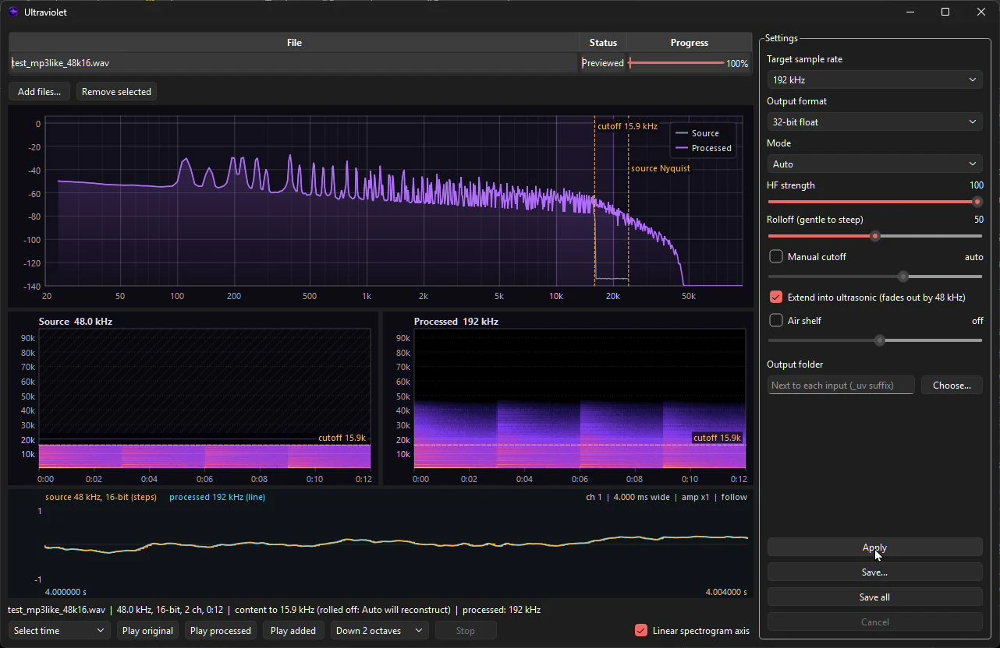

<div align="center">


# Ultraviolet

**An audio upscaler that shows its work, because nobody else in this hobby will.**

[](https://github.com/Locke-Werks/Ultraviolet/releases)
[](LICENSE)
[](#requirements)

</div>

---



Here is how upsampling usually goes. You pay for a program, or a plugin, or a
plugin that hosts other plugins. You feed it a 48 kHz file. It hands back a
384 kHz file roughly eight times the size, and a forum thread assures you it
sounds "more analog." Nobody shows you a spectrum. Nobody shows you a single
sample. You are expected to take it on faith, and when you ask what actually
changed, someone tells you to buy better cables.

Ultraviolet is the opposite of that. It converts audio to 88.2 through 384 kHz,
in 32-bit or 64-bit float, and when the source has had its top end chopped off
by a codec or a lazy master, it builds a high-frequency extension that picks up
where the music stopped. Then it shows you exactly what it did: the spectrum,
the spectrograms, the individual samples, and an audition of nothing but the
added content so you can decide for yourself whether you like it.

Nothing is written to disk until you say so.

## What it does, and what it does not

Two jobs. They are different jobs, and pretending otherwise is how this whole
category got its reputation.

**Conversion.** An arbitrary-ratio linear-phase resampler (r8brain) takes the
source to the target rate, and the result is stored as 32-bit float, 64-bit
float, or 24-bit PCM with TPDF dither and noise shaping. Below the source's
cutoff, the output is the input. The tests measure the difference at around
-89 dB, which is rounding error, and that is the point: conversion is supposed
to be boring.

**Extension.** A 48 kHz file can hold everything up to 24 kHz. An MP3, a
streaming master, or a lot of older digital transfers do not: something
brickwalled them at 16 or 19 kHz and threw the rest away. That information is
gone. No program recovers it, and any program that says it does is lying to
you. What Ultraviolet does instead is synthesize a plausible continuation, and
it is upfront that this is synthesis.

## How the extension is built

It is spectral band replication, the same idea AAC+ and Opus use to rebuild
highs from lows, run offline at the target rate with no budget to cut corners.

1. **Find the cliff.** The analyzer looks for a real low-pass cliff in the
   spectrum, not a dip in the music. It reports the shoulder frequency, the
   slope approaching it, and the noise floor beneath it. A full-band source is
   left alone in Auto mode.
2. **Copy the octave below.** In short overlapping FFT frames, the octave
   under the cutoff is shifted up to fill the space above it, then again until
   the extension reaches its ceiling. A hi-hat at 10 kHz produces energy at
   20 kHz in the same frame, so the extension follows the music's transients
   instead of hissing at a constant level.
3. **Fix the phase.** Moving a bin up in frequency without advancing its phase
   at the new rate sounds metallic. Each copied bin is corrected.
4. **Flatten it.** The copied band is whitened so it keeps its texture and
   timing but not the formants and resonances of the midrange it came from.
   Without this you get the same vocal shape stamped up the spectrum in bands.
5. **Mix in some noise.** A third of the energy is replaced with seeded noise,
   so tonal sources read as air rather than ghost harmonics. It is seeded, so
   the same file gives the same output every time.
6. **Shape the level.** The extension starts at the music's own level at the
   cutoff, measured per frame with a 60 ms release, continues the slope the
   source had going into the cliff, then rolls off faster as it climbs, with a
   raised-cosine fade to silence at 22 kHz or, with ultrasonic on, 48 kHz.
7. **Crossfade.** A short power-complementary crossfade below the cutoff hands
   over from the original to the extension. Measured worst-case step at the
   seam: 0.82 dB. Below the crossover band the original is untouched.

A four-minute stereo track at 192 kHz takes about five seconds.

## Features

### Output

- Target rates: 88.2, 96, 176.4, 192, 352.8 and 384 kHz.
- Formats: 32-bit float, 64-bit float, or 24-bit PCM with TPDF dither and
  first-order noise shaping. 384 kHz in 64-bit float is bit-exact through a
  save and reload, and the tests check it.
- Files over 4 GB are written as RF64 automatically. Anything smaller stays
  plain RIFF, so editors that have never heard of RF64 still open it.
- Inputs: WAV, FLAC, AIFF.

### Modes

- **Mastering:** conversion only. Nothing synthesized, ever.
- **Rescue:** always extend.
- **Auto:** extend only when the analyzer finds a cliff. This is the default.

### Extension controls

- **HF strength.** 100 starts the extension at exactly the source's level at
  the cutoff. Lower values leave a step.
- **Rolloff.** How fast the extension falls away above the cutoff, from gentle
  to steep.
- **Extend into ultrasonic.** Fades out by 48 kHz instead of 22 kHz.
- **Manual cutoff.** Overrides the detected cutoff, 2 to 24 kHz. Set it below
  the real cutoff and the extension is added over the original instead of
  replacing it, which thickens the upper audible band without throwing away a
  single real sample. Set it too low and you will hear exactly why the default
  is the detected value.
- **Air shelf.** A linear-phase mastering tilt: flat below 4 kHz, rising
  smoothly to the set gain at 20 kHz (6.5 dB by default, up to 12) and held
  through the ultrasonic, extension included. This changes the audible band on
  purpose, so it applies in every mode, Mastering too. It can push a loud
  master past full scale; float output does not care, 24-bit output clips.

### Preview before you commit

Selecting a file loads and analyzes it. **Apply** processes it in memory.
**Save** and **Save all** are the only buttons that write anything, and Save
all asks before overwriting.

- **Spectrum** on a log-frequency axis with peak hold, the detected cutoff and
  the source Nyquist marked, and a hover readout.
- **Spectrograms** of the source and the result side by side on one shared
  frequency axis, linear or log, so the added content lines up against what
  the source was missing.
- **Waveform** at the sample level. The original is drawn as the staircase its
  samples actually are, at its own rate. The result is drawn as a line at the
  target rate over it. Zoom the amplitude far enough and the original's 16-bit
  quantization grid appears, one line per step, with the original locked to it
  and the float output moving freely between the lines. During playback it
  scrolls under the playhead.

  The staircase is how the samples are stored, not what a DAC plays; any DAC
  draws its own smooth curve through them. What the line shows you that the
  staircase cannot is the finer resolution and the new high-frequency detail.

  | Waveform control | Does |
  |---|---|
  | Wheel | Zoom time around the cursor |
  | Ctrl + wheel | Zoom amplitude, up to a million times |
  | Drag | Pan |
  | Double-click | Reset |
  | C | Next channel |
  | F | Follow the playhead on or off |

### Listening

- **Play original** and **Play processed** for straight A/B.
- **Play added** subtracts a plain resample of the original from the result.
  The original cancels exactly, and what is left is only what Ultraviolet put
  there. Most of it is above what you can hear, so it can be moved down:

  | Audition | What it does |
  |---|---|
  | Unshifted | As is. Only the part below 20 kHz is audible |
  | Down 1 / 2 octaves | Pitch lowered, timing kept. A 32 kHz tone comes out at 8 kHz, onsets land on time |
  | Slowed 2x / 4x | Played slower, which lowers every frequency by the same factor with no processing at all |

  The audition is normalized to -6 dBFS and the status line tells you how much
  gain that took, so a loud audition is not mistaken for a loud extension. The
  octave shift adds a little smear of its own; if something sounds wrong, check
  it slowed before blaming the extension.
- **Selections**, iZotope RX style. Choose **Select time**, **Select
  frequency** or **Select box** and drag on either spectrogram. Every play
  button then plays only the selection: the time span cut out, the band
  isolated, or both. Edges are smoothed so nothing clicks. In the shifted and
  slowed auditions the selection is translated for you, so a box drawn at 20 to
  30 kHz isolates the 5 to 7.5 kHz you are actually hearing.

## Requirements

Windows 11 x64. The installer carries the Qt runtime and the Visual C++
runtime, so there is nothing else to install.

## Install

Download `Ultraviolet-Setup.exe` from
[Releases](https://github.com/Locke-Werks/Ultraviolet/releases). It is signed.
The publisher shows as Specter Point Intelligence, LLC, which is the parent
company and is correct.

## Building

Visual Studio 2022 or newer, CMake 3.24+, Qt 6 (Widgets, Multimedia,
Concurrent), and vcpkg in manifest mode for libsndfile, FFTW3 and Catch2.

```
cmake --preset default
cmake --build build --config Release
build\tests\Release\uvtests.exe
```

The `default` preset expects vcpkg at `C:\vcpkg` and Qt at
`C:\Qt\6.11.3\msvc2022_64`. Change `CMakePresets.json` if yours live
elsewhere. The `ci` preset reads both from the environment instead.

The build runs `windeployqt` after linking, so the exe in `build\src\app\Release`
runs in place.

## Layout

- `src/core`: `uvcore`, the DSP library. No Qt. File IO, resampling, analysis,
  the extension, dither, the air shelf, auditions, selections.
- `src/app`: the Qt 6 application.
- `tests`: Catch2 tests against `uvcore`. They measure things, in dB, rather
  than checking that functions return.
- `third_party`: r8brain-free-src, vendored.

The extension sits behind an `HfSynthesizer` interface so a learned model can
replace the algorithm later without touching anything else.

## License

GPLv3. See [LICENSE](LICENSE) and [THIRD_PARTY.md](THIRD_PARTY.md).
